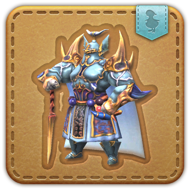

# Sawoo Boss Scaler

A Dalamud plugin for FINAL FANTASY XIV that changes the size of ultimate bosses. Pick a size for each boss in each phase, and it changes as the fight moves from one phase to the next.

Covers The Unending Coil of Bahamut, The Weapon's Refrain, The Epic of Alexander, Dragonsong's Reprise, The Omega Protocol, Futures Rewritten and Dancing Mad.

## Install

1. Open Dalamud Settings → Experimental.
2. Under Custom Plugin Repositories, add
   `https://raw.githubusercontent.com/Sayuuryi/SawooPlugins/main/repo.json`
   and click Save.
3. Search for **Sawoo Boss Scaler** in the plugin installer.

Open it with `/sbs`, or `/sbs config` for the settings.

To try new versions early, right-click the plugin in the installer and turn on **Receive plugin testing versions**.

## Credits

Game structures come from [FFXIVClientStructs](https://github.com/aers/FFXIVClientStructs). Phase timings are based on [cactbot](https://github.com/OverlayPlugin/cactbot)'s fight data.
